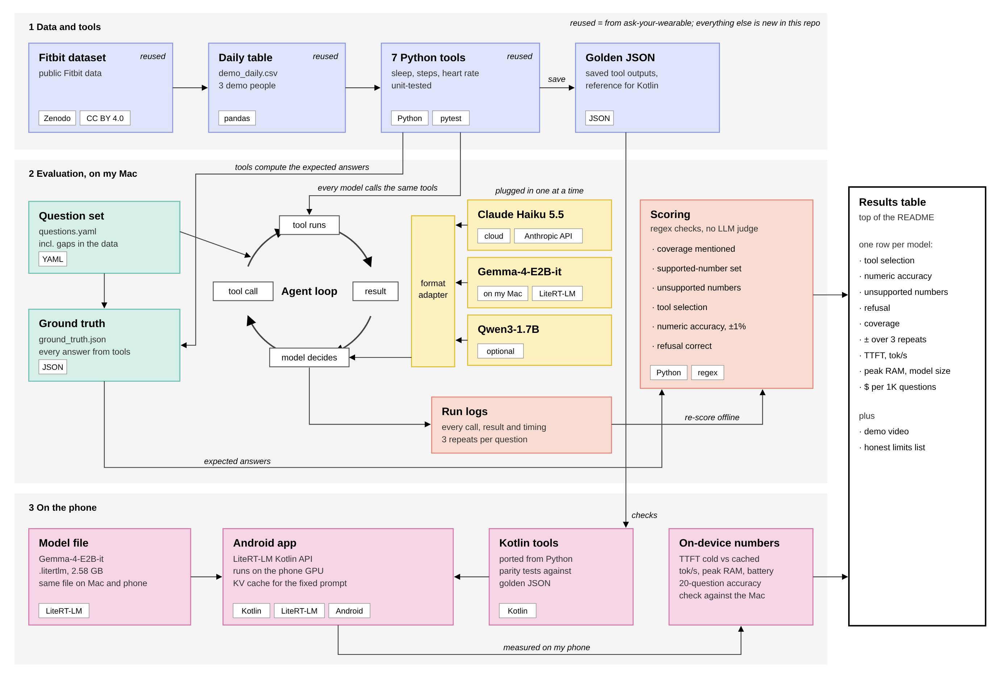

# wearable-agent-eval

> **Status: in progress** (updated 2026-11-26)
>
> ✅ **Last done:** a draft results table (scorer v1.1, before blind labeling) and 3 Gemma failure examples, written into this README by `scripts/make_results_table.py` from `runs/final/`.
>
> 🔜 **Next:** Gemma with constrained decoding off (x1), then blind labeling of 60 answers.

<details>
<summary><b>Plan and progress</b></summary>

**Done so far**
- [x] Set up the repo and copied the tools and demo data from [ask-your-wearable](https://github.com/sumeyye-agac/ask-your-wearable), with its tests passing
- [x] Gemma-4-E2B-it runs on my Android phone (Google AI Edge Gallery): ~10 vs ~6.5 tok/s decode on GPU vs CPU, ~3.0 vs ~2.2 GB RAM; time-to-first-token with the full agent prompt (5,145 tokens, Gemma tokenizer): 29.6 s on GPU
- [x] A 28-question pilot set (questions v1); every expected answer is computed by the tools, none written by hand
- [x] A runner that saves every run to `runs/`, and a scorer that reads only the saved runs
- [x] A Claude Haiku 5.5 pilot run on questions v1 (not reported as a result: the scorer is not validated yet)
- [x] A LiteRT-LM spike on my Mac: Gemma-4-E2B-it makes valid tool calls and is deterministic at temperature 0

**A. Freeze the inputs**
- [x] Question set v1.4
- [x] Prompt v1.1
- [x] Scorer v1.1 with validation: null baseline, mutation test, labeling policy, and decision rules written before any Gemma output is read

**B. Runs on the frozen inputs**
- [x] Claude Haiku 5.5: thinking off x3 (main), thinking on x1
- [x] Gemma-4-E2B-it on my Mac: main run x1; determinism checked on 3 questions
- [ ] Blind labeling of 60 answers
- [ ] First comparison table and failure taxonomy

**C. Phone and questions v2**
- [ ] KV cache for the fixed part of the prompt
- [ ] Latency and RAM on the phone
- [ ] 20-question parity between the phone and the Mac runs
- [ ] Demo video
- [ ] Question set v2

</details>

## How it works


How accurate is a small on-device model, compared with a cloud model, when both answer
health-data questions with the same tested tools? And what does it gain in latency, memory
and battery?

The agent and the tools come from
[ask-your-wearable](https://github.com/sumeyye-agac/ask-your-wearable). The copy here is
from commit `a725a58`. The cloud reference is Claude Haiku 5.5, and the on-device model is
Gemma-4-E2B-it.

## Results

<!-- results:start -->
*Draft: scorer v1.1, before blind labeling. Questions v1.4: 34 questions, 8 of them should be refused. Written by `scripts/make_results_table.py` from `runs/final/`; no number here is typed by hand.*

| Run | Repeats | End-to-end pass | Refusal correct | Valid tool calls |
| --- | --- | --- | --- | --- |
| Claude Haiku 5.5, thinking off | 3 | mean 93.1%, runs 85.3%–97.1%<br>CI 79.6%–97.9% | mean 91.7%, runs 75.0%–100.0%<br>CI 57.4%–98.9% | mean 89.7%, runs 87.8%–90.7%<br>CI 76.9%–95.8% |
| Gemma-4-E2B-it, Mac CPU, constrained decoding | 1 | 13/34 = 38.2%<br>CI 23.9%–55.0% | 3/8 = 37.5%<br>CI 13.7%–69.4% | 29/32 = 90.6%<br>CI 75.8%–96.8% |
| Claude Haiku 5.5, thinking on (side row) | 1 | 32/34 = 94.1%<br>CI 80.9%–98.4% | 7/8 = 87.5%<br>CI 52.9%–97.8% | 34/40 = 85.0%<br>CI 70.9%–92.9% |

- CI is a 95% Wilson interval. For one run it uses that run's k/n. For Haiku thinking off it uses the mean over the 3 runs with n = 34 questions (8 for refusal), because the 3 runs repeat the same questions and are not independent; pooling them as 102 answers would make the interval too narrow.
- Valid tool calls count calls, not questions (n differs per run); the Haiku CI uses the mean number of calls per run. Calls are not independent either: one answer can make several.
- Refusal has only 8 questions per run, so its intervals are wide; the Haiku (thinking off) and Gemma intervals overlap, so the refusal gap is not clear yet.
- Gemma ran once at temperature 0; a rerun of 3 questions gave identical calls and answers.

**Gemma failure examples.** Each failed answer is put in the first kind it fits, in this order; the example is the first such answer by question id.

**Failed refusal: answered a question it should have refused** (5 of 34 answers). Example: `una-04`, "Was I active enough in the week ending 22 March 2016?"

- Expected: refuse, after `weekly_active_minutes({"end_date": "2016-03-22"})`
- Gemma called: `weekly_active_minutes({"end_date": "2016-03-22"})`
- Why it failed: no refusal wording in the answer
- Gemma answered:

> The combined moderate-equivalent minutes for the week ending 2016-03-22 was 73 minutes, which is below the recommended 150 minutes. The vigorous-equivalent minutes were 20 minutes, which is below the recommended 75 minutes.
>
> The caveat is that Fitbit's fairly active and very active minutes are the d …

**Wrong tool result: wrong tool, wrong arguments or wrong route** (12 of 34 answers). Example: `act-05`, "What were my five highest step days in April 2016?"

- Expected: `most_active_day({"end_date": "2016-04-30", "start_date": "2016-04-01", "top_n": 5})`
- Gemma called: `most_active_day({"end_date": "2016-04-30", "top_n": 5})`
- Why it failed: `top_days.4.date` expected "2016-04-29", got "2016-03-14"; `top_days.4.steps` expected 12764, got 13625
- Gemma answered:

> The five highest step days in April 2016 were:
> 1. 2016-04-14 with 17022 steps on a Thursday.
> 2. 2016-04-15 with 16556 steps on a Friday.
> 3. 2016-04-19 with 15482 steps on a Tuesday.
> 4. 2016-04-07 with 15444 steps on a Thursday.
> 5. 2016-03-14 with 13625 steps on a Monday.

**Missing coverage note: does not say how many days of data it used** (4 of 34 answers). Example: `act-03`, "Was I active enough this week?"

- Expected: `weekly_active_minutes({})`
- Gemma called: `weekly_active_minutes({"end_date": "2016-05-10"})`
- Why it failed: the tool result covers 5 days with data; the answer does not say so
- Gemma answered:

> Based on the data for the week of 2016-05-04 to 2016-05-10, you were active enough.
>
> The combined moderate-equivalent minutes were 592 minutes against the recommendation of 150 minutes. This counts 1 vigorous minute as 2 moderate minutes.
> *   Moderate-equivalent minutes: 592 minutes
> *   Moderate min …
<!-- results:end -->

## Layout

| Path | Contents |
| --- | --- |
| `src/wearable/` | Tools, schema and agent loop, copied from ask-your-wearable; changes: `ask()` takes `system=` and `tools=`, and sleep results also give decimal hours and `night_of` |
| `src/wearable_eval/` | Question loading, ground truth, prompt v1.1 (`prompt_v1.py`), runner and scoring |
| `runs/` | Saved runs: `final/` is committed, `dev/` stays local |
| `eval/` | Question set and generated ground truth ([format](eval/README.md)) |
| `data/demo/` | Daily table for 3 demo users |
| `android/` | On-device app (not started) |

## Run it

```bash
python3.11 -m venv .venv
.venv/bin/pip install -r requirements-dev.txt
.venv/bin/pip install -r requirements-litert.txt   # only for Gemma runs
.venv/bin/python -m pytest
.venv/bin/python scripts/build_ground_truth.py

# Needs ANTHROPIC_API_KEY (a git-ignored .env file works); costs money
.venv/bin/python scripts/run_eval.py                       # 3 repeats into runs/dev/
.venv/bin/python scripts/run_eval.py --resume runs/dev/<run>  # continue an interrupted run
.venv/bin/python scripts/score_run.py runs/dev/<run>          # never calls a model
.venv/bin/python scripts/make_results_table.py [--check]    # README results block from runs/final/
```

## Data

Furberg, Brinton, Keating & Ortiz (RTI International), *Crowd-sourced Fitbit datasets
03.12.2016–05.12.2016*, Zenodo, 2016, [doi:10.5281/zenodo.53894](https://doi.org/10.5281/zenodo.53894),
CC BY 4.0. The files in `data/demo/` are derived from it under the same licence.
Wellness information only; nothing here diagnoses anything.
